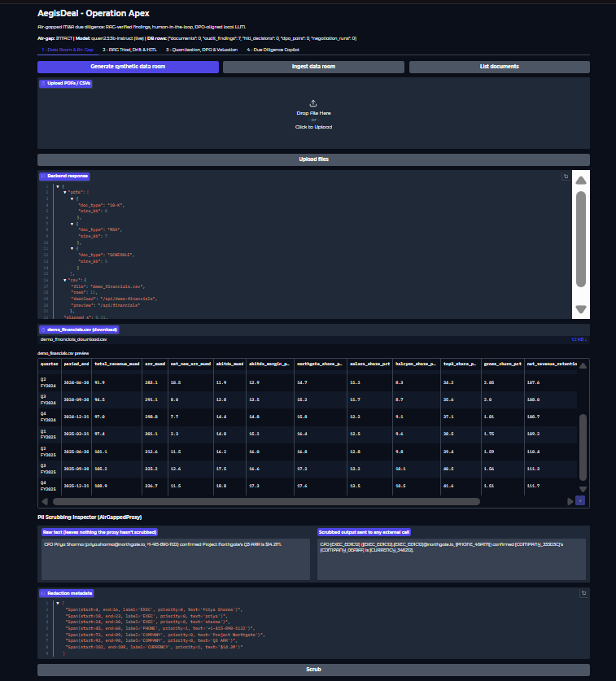

# AegisDeal (Operation Apex)

**Air-gapped, local-first M&A due diligence and contract risk auditing.**
Ingest a data room, extract clause risk with a local quantized LLM, verify every claim with a RAG Triad, align the model from analyst decisions, and query the result through a tool-grounded copilot. Nothing leaves the machine.

---

## 1. Project Overview & Core Architecture

One FastAPI process serves both the REST API (`/api/*`) and a four-tab Gradio UI (`/ui/`) on a single port.

| Tab | Workflow | What it does |
|---|---|---|
| **1. Deal Room Ingestion & PII Scrubbing** | Upload PDFs/CSVs or generate the synthetic data room | Parses, scrubs PII locally, chunks, embeds and indexes documents; previews `demo_financials.csv` |
| **2. RAG Triad Clause Risk Audit** | Extract clauses, score, retract | Scores each finding with the RAG Triad, runs the drift monitor, and retracts findings that fail verification |
| **3. Human-in-the-Loop DPO Alignment & Quantized Footprint** | Approve / override / reject | Analyst decisions become `(chosen, rejected)` preference pairs; shows Q4_K_M vs FP16 memory and runs a live DPO step |
| **4. Air-Gapped Deal Copilot** | Chat | Tool-grounded answers over findings, the financial CSV, valuation math and the egress log |

```
                         ┌───────────────────────────────────────────────┐
                         │          Single process: python app.py        │
                         │                                               │
  Browser ──:7860/ui/──▶ │  Gradio Blocks (4 tabs)                       │
  curl    ──:7860/api/─▶ │  FastAPI  (backend/server.py)                 │
                         └───────────────┬───────────────────────────────┘
                                         │
   Data room (PDF / CSV)                 ▼
          │             ┌────────────────────────────────┐
          └───────────▶ │ security/proxy.py  PII scrub   │  (spaCy en_core_web_lg)
                        └───────────────┬────────────────┘
                                        ▼
                        ┌────────────────────────────────┐
                        │ pipeline/ingest.py  chunk+embed│  BAAI/bge-large-en-v1.5
                        │ pipeline/csv_ingest.py         │
                        └──────┬──────────────────┬──────┘
                               ▼                  ▼
                        ChromaDB (vectors)   SQLite (backend/db.py)
                               └────────┬─────────┘
                                        ▼
                        ┌────────────────────────────────┐
                        │ llm/extractor.py               │  qwen2.5:3b-instruct Q4_K_M (Ollama)
                        │  └─ RuleTemplateEngine fallback│
                        └───────────────┬────────────────┘
                                        ▼
                        observability/triad_eval.py  ──▶ RAG Triad
                        observability/drift_monitor.py ─▶ semantic drift
                                        ▼
                        HITL gate ──▶ llm/quant_dpo.py (DPO pairs, Bradley-Terry step)
                                        ▼
                        agents/negotiation.py ──▶ report/synthesizer.py (memo)
                                        ▼
                        agents/copilot.py  (tool-grounded chat)

  ═════ security/network_guard.py: socket + DNS egress guard around everything ═════
```

---

## 2. Security & Local Processing Guarantee

- **Zero external egress.** `security/network_guard.py` enforces the guarantee at the socket and DNS level. Only loopback (`127.0.0.1`) and the Docker bridge are allowlisted, so the app can reach a local Ollama server and nothing else. Blocked attempts are recorded and surfaced through the egress audit and the copilot (*"Was anything sent outside?"*).
- **Local PII scrubbing.** `security/proxy.py` (`AirGappedProxy`) redacts personal data with spaCy `en_core_web_lg` before text reaches prompts, logs or reports.
- **Offline models.** Set `HF_HUB_OFFLINE=1` so HuggingFace never attempts a network fetch. Embeddings and ChromaDB run fully on local disk.
- **Health check.** `GET /api/health` reports air-gap status, the active model (live Ollama or rule fallback) and database row counts.

---

## 3. Tech Stack & Model Specifications

| Layer | Choice |
|---|---|
| Embeddings | `BAAI/bge-large-en-v1.5` (SentenceTransformers) |
| Vector store | ChromaDB (persistent, local) |
| Relational store | SQLite (`backend/db.py`) |
| LLM | `qwen2.5:3b-instruct`, 4-bit `Q4_K_M` GGUF, served by Ollama |
| LLM fallback | `RuleTemplateEngine` (`llm/quant_dpo.py`), used when Ollama is unreachable |
| Alignment | CPU-native DPO / Bradley-Terry step (`llm/quant_dpo.py`) |
| PII | spaCy `en_core_web_lg` |
| Torch | CPU-only PyTorch |
| API / UI | FastAPI + Gradio, UI mounted at `/ui/` |

Quantization footprint for the demo model: about 1.9 GB (Q4_K_M) vs about 6.2 GB (FP16). Live numbers: `GET /api/quant`.

---

## 4. Reproducibility & Quickstart


### Option A: Local Docker (self-contained or host Ollama)

The `Dockerfile` bundles Ollama and `qwen2.5:3b-instruct` directly inside the image, so you can run the entire stack with a single command:

```bash
# 1. Build the self-contained image
docker build -t aegisdeal .

# 2. Run with bundled Ollama (persists SQLite & ChromaDB state to ./apex_data)
docker run --rm -p 7860:7860 \
  -v $(pwd)/apex_data:/app/apex_data \
  aegisdeal
```

(Optional) If you already run Ollama on your host machine `(OLLAMA_HOST=0.0.0.0:11434 ollama serve)` and want the container to use your host's model cache instead, pass the Docker bridge URL:

```bash
docker run --rm -p 7860:7860 \
  --add-host=host.docker.internal:host-gateway \
  -e APEX_LLM_URL=[http://172.17.0.1:11434](http://172.17.0.1:11434) \
  -v $(pwd)/apex_data:/app/apex_data \
  aegisdeal
```

Open **http://127.0.0.1:7860/ui/**

> If the page resets the connection, the server inside the container is not bound to `0.0.0.0`; check `APEX_HOST`.

### Option B: Bare-Metal Python Environment

```bash
python -m venv .venv && source .venv/bin/activate     # Windows: .venv\Scripts\activate

# CPU-only PyTorch first, then the rest
pip install torch --index-url https://download.pytorch.org/whl/cpu
pip install -r requirements.txt

# spaCy model for PII scrubbing
python -m spacy download en_core_web_lg

# Embedding model (weights are not in Git); cached under ~/.cache/huggingface
python -c "from huggingface_hub import snapshot_download; snapshot_download('BAAI/bge-large-en-v1.5', local_dir='./models/bge-large-en-v1.5')"

# Local LLM
ollama pull qwen2.5:3b-instruct

# Run offline
export HF_HUB_OFFLINE=1
export APEX_LLM_URL=http://127.0.0.1:11434
python app.py
```

Open **http://127.0.0.1:7860/ui/**. After the one-time downloads, the machine can be disconnected.

### Option C: Cloud Deployment (Render)

The `Dockerfile` is self-contained (bundling `BAAI/bge-large-en-v1.5`, `en_core_web_lg`, Ollama, and `qwen2.5:3b-instruct`), and `render.yaml` defines the web service so Render can build straight from the repository:

1. Push the repo to GitHub.
2. In Render: **New → Blueprint** (or **New → Web Service**), select the repo, and confirm `render.yaml` / `Dockerfile` is detected.
3. Choose an instance with **at least 2 GB RAM (Standard)** or **4 GB RAM (Pro)** so the embedding model, spaCy pipeline, and local `qwen2.5:3b-instruct` daemon fit comfortably in memory.

Because Ollama is bundled inside the container over `127.0.0.1:11434`, Render runs the live quantized `qwen2.5:3b-instruct` model locally inside the service (falling back to `RuleTemplateEngine` only if `APEX_LLM_URL` is unreachable or omitted). Once deployed, open `https://<your-service-name>.onrender.com/ui/`.

---

## 5. Configuration & Environment Variables

| Variable | Purpose | Example value |
|---|---|---|
| `APEX_HOST` | Interface the server binds to | `0.0.0.0` |
| `APEX_PORT` | Port for UI and API | `7860` |
| `APEX_LLM_URL` | Ollama base URL | `http://172.17.0.1:11434` (Docker), `http://127.0.0.1:11434` (bare metal) |
| `APEX_LLM_MODEL` | Ollama model tag | `qwen2.5:3b-instruct` |
| `APEX_EMBED_MODEL` | Embedding model | `BAAI/bge-large-en-v1.5` | # ./models/bge-large-en-v1.5
| `APEX_SPACY_MODEL` | spaCy model for PII scrubbing | `en_core_web_lg` |
| `HF_HUB_OFFLINE` | Block all HuggingFace network access | `1` |

---

## 6. Repository Structure & Reproducibility Notes

```
.
├── app.py                    # Entry point: FastAPI + Gradio on one port
├── main.py                   # CLI pipeline runner
├── gui.py
├── config.py                 # Reads APEX_* environment variables
├── create_demo_pdf.py
├── Dockerfile
├── render.yaml
├── requirements.txt
├── MSA_Northgate_Logistics_MSA-2023-004817.pdf   # demo contract
├── agents/
│   ├── copilot.py            # Tool-grounded copilot, EgressMonitor, FindingsStore
│   ├── negotiation.py        # Multi-agent valuation loop
│   ├── core.py  graph.py  nodes.py
├── backend/
│   ├── server.py             # FastAPI app and /api/* routes
│   └── db.py                 # SQLite access
├── data/
│   └── synthetic_gen.py      # Synthetic data room generator
├── llm/
│   ├── extractor.py          # Clause extraction
│   └── quant_dpo.py          # Quantization report, DPO, RuleTemplateEngine
├── observability/
│   ├── triad_eval.py         # RAG Triad
│   └── drift_monitor.py      # Semantic drift
├── pipeline/
│   ├── ingest.py             # Chunking, embedding, ChromaDB
│   └── csv_ingest.py
├── report/
│   └── synthesizer.py        # Investment memo
├── security/
│   ├── network_guard.py      # Socket/DNS egress guard
│   └── proxy.py              # AirGappedProxy (PII scrubbing)
└── docs/
    └── REFACTORING_LOG.md
```

**What is excluded from Git, and why**

- `*.safetensors`, `*.bin`: model weights are hundreds of MB to GB, exceed GitHub file limits, and are not source. They are fetched once, either at `docker build` time or by the Option B commands above.
- `apex_data/`: runtime state (SQLite, ChromaDB, `dpo_preferences.jsonl`, generated memo). It is recreated by `POST /api/generate-demo` and the ingest/audit steps, and may contain scrubbed deal data that should never be committed.
- `env/`, `.venv/`, `__pycache__/`: local environment and bytecode.


**API surface** (all under the same port): `/api/health`, `/api/quant`, `/api/generate-demo`, `/api/financials`, `/api/demo-financials`, `/api/upload`, `/api/ingest`, `/api/documents`, `/api/audit/run`, `/api/findings`, `/api/hitl/resolve`, `/api/negotiate`, `/api/negotiations/latest`, `/api/dpo/stats`, `/api/dpo/step`, `/api/chat`.

**Single-writer note:** SQLite and ChromaDB expect one process per `apex_data/` directory. Do not run `main.py`, `app.py` and the container against the same directory at the same time.